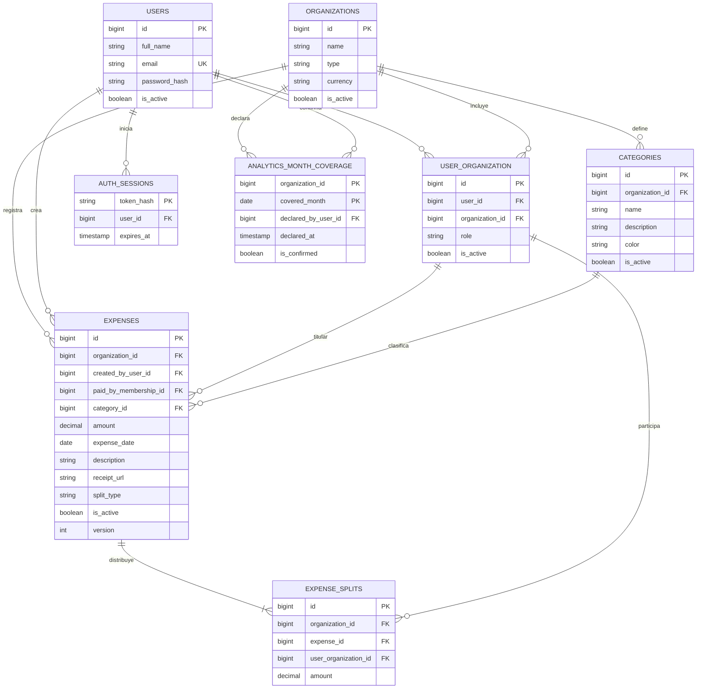

# Shareverance

Fecha de revisión: 21/10/2026. Base revisada: `9ea8ce4` (main, incluye PR #60). La evidencia histórica conserva sus fechas y alcances.

Esta especificación define el comportamiento requerido del MVP 1. La sección de estado distingue código existente de trabajo pendiente. La revisión es estática; no acredita ejecución de pruebas.


Sistema de registro, distribución y análisis de gastos para hogares, consorcios y universidades. MVP: organizaciones, roles, miembros, categorías, carga manual/OCR, historial, calendario, panel y predicción. ARS única; sin tesorería ni liquidaciones.

## Documentación

- [Instrucciones para agentes](AGENTS.md)
- [Alcance y reglas](docs/alcance_mvp.md)
- [Java](docs/java.md)
- [Python: analítica y predicción](docs/python_predictor.md)
- [Python: OCR](docs/python_ocr.md)
- [PostgreSQL](docs/postgre.md)
- [Frontend](docs/front.md)
- [Contratos API](docs/contratos_api.md)
- [Roadmap y aceptación](docs/road_map.md)

## Arquitectura y estado

React/TypeScript/Vite; Java Spring Boot/JDBC; Python FastAPI; PostgreSQL; Docker Compose.

Actual: React→Java→PostgreSQL para negocio; Java autoriza y orquesta hacia Python (`POST /internal/v2/predictions/monthly` con Bearer interno) y Python consulta directamente las vistas SQL de PostgreSQL con su rol de solo lectura (`shareverance_python`), devolviendo predicciones simuladas. E4.2 incorpora OCR local Tesseract desde el volumen privado, precarga editable y asociación transaccional del comprobante al confirmar el gasto. La carga manual sigue disponible si falla OCR. E5.2 incorpora la consulta pública Java y el panel analítico con gráficos SVG y tablas accesibles. SES está implementado como candidato experimental y la vista predictiva E6.2 existe; la aceptación predictiva e integral permanecen pendientes.

E3.1 incorpora V7: vistas analíticas aisladas por contexto transaccional, cobertura explícita por mes cerrado y credenciales separadas para migración, Java y lectura Python. E3.2 incorpora el consumidor Python de vistas (`ViewsRepository` con `psycopg[binary]`), la llamada autenticada `Java → Python` (`GET /api/v1/organizations/{id}/predictions/monthly` → `POST /internal/v2/predictions/monthly`) con soporte de rotación de secreto (`PYTHON_CLIENT_SECRET` / `PYTHON_CLIENT_SECRET_PREVIOUS`) y el retiro del callback `Python → Java` (`/api/v1/auth/token`, `/api/v1/expenses/organization/{id}/history` y `GET /api/v1/predictions/organization/{id}/monthly`). Contratos y permisos en [PostgreSQL](docs/postgre.md) y [API](docs/contratos_api.md).

Frontend existente: registro/login, restauración y cierre de sesión, creación/listado/selección de organizaciones y pestañas de gastos, miembros y categorías. E2.1 incorpora carga manual y listado de gastos, alta de miembros por email, cambio de rol, desactivación/reactivación y alta/desactivación de categorías. E2.2 agrega historial filtrado y paginado, detalle, edición con versión y anulación confirmada de gastos. E2.3 incorpora la vista alternable de calendario mensual con totales diarios y consulta/detalle por fecha dentro de la pestaña de gastos. E5.2 agrega la pestaña Panel con totales, comparación mensual, evolución y categorías; la edición de categorías sigue pendiente. La especificación incorpora calendario y preserva funciones existentes.

E1.2 implementa reparto individual e igualitario determinista y validaciones monetarias exactas; conserva el guardado transaccional de gastos y partes. No agrega migraciones ni amplía el MVP a reparto personalizado. Evidencia y límites en el [roadmap](docs/road_map.md).

La corrección OCR permite solicitar procesamiento con sesión/CSRF, mejora fotos mediante orientación, recorte y contraste y evita reutilizar campos de otro comprobante. Fecha e importe siguen sujetos a revisión antes de registrar; los valores no reconocidos quedan vacíos. Implementación y límites en [Python OCR](docs/python_ocr.md), con validación manual de los casos probados y evidencia automatizada en el [roadmap](docs/road_map.md).

E5.1 tiene implementada la analítica interna Python desde vistas SQL y su verificación con PostgreSQL real: 95 pruebas Python aprobadas, sin omisiones, sobre datos sintéticos aislados. E5.2 incorpora la consulta pública Java y el panel React, con períodos de meses cerrados, cobertura explícita y gráficos SVG sin dependencias nuevas. Evidencia y límites en el [roadmap](docs/road_map.md), con el conjunto de comprobación en [PostgreSQL](docs/postgre.md).

## Inicio rápido

Comparación descriptiva de ventanas 4/5/6 meses en desarrollo: `scripts/predictor-demo.ps1 compare`, sin iniciar servicios. [Guía P4-H, resultados y límites](docs/evidencia/p4h/README.md). No acepta modelos ni habilita una UI multimes; la aplicación sigue siendo mensual.

Evaluación experimental del CSV en desarrollo: [guía P3](docs/python_predictor.md#evaluador-p3), `scripts/predictor-demo.ps1 evaluate -FromMonth 2024-01 -ToMonth 2024-12`. No requiere iniciar servicios y bloquea la reserva de 2025; el resultado no acepta ni activa modelos.

Para pruebas integradas del predictor con datos del CSV, usar la [guía P1-D](docs/python_predictor.md#entorno-demo-predictor): `scripts/predictor-demo.ps1 start`, luego `load` y `check`. Crea un proyecto separado en localhost:5176 con usuario, organización y gastos de 2023–2024, sin alterar el entorno habitual. La guía incluye credenciales sintéticas, filtros históricos, detención y límites; la previsión disponible sigue siendo de un mes.

El [plan complementario del predictor P1–P5](docs/road_map.md#plan-complementario-del-predictor) permite coordinar evaluación e integración con el equipo. Para probar el CSV de demostración sin modificar la base ni los servicios, seguir la [guía de evaluación offline](docs/python_predictor.md#evaluación-con-el-csv-de-demostración). Distingue el comando disponible hoy del evaluador completo y de la aceptación todavía pendientes.

E6.1 incorpora SES como candidato experimental. P5 documenta la decisión conservadora de no promover SES 0.3 con la evidencia sintética disponible; no acredita evaluación final ni aceptación predictiva. Se mantiene `PREDICTOR_MODE=mock` predeterminado y SES opcional experimental. P2 conserva umbrales propuestos; P2-H requiere acordar criterios por horizonte. Evidencia y comandos en [Python](docs/python_predictor.md) y [P5](docs/evidencia/p5/README.md).


Requisitos: Git y Docker Desktop iniciado, con contenedores Linux y Docker Compose 2.20 o posterior. En Windows se usa WSL 2. No es necesario instalar Java, Python, Node.js o PostgreSQL por separado. La primera ejecución necesita Internet para descargar imágenes y dependencias.

Los comandos siguientes se ejecutan en PowerShell.

### 1. Clonar el repositorio

```powershell
git clone https://github.com/seba615/shareverance shareverance
Set-Location shareverance
```
Seleccionar la rama que se desea ejecutar antes de iniciar contenedores; revisar primero su estado y sus migraciones.

### 2. Crear la configuración local

```powershell
Copy-Item .env.example .env
```

Revisar las credenciales de `.env`. Este archivo es personal y no se sube a Git. La copia de `.env.example` incluye `PYTHON_CLIENT_SECRET` (y `PYTHON_CLIENT_SECRET_PREVIOUS` opcional para rotación) para autenticar las llamadas internas `Java → Python`; son valores solo para desarrollo y deben reemplazarse antes de cualquier despliegue.

E3.1 y E3.2 utilizan `JAVA_DB_PASSWORD` y `PYTHON_DB_PASSWORD`; agregar ambas a un `.env` existente y elegir valores distintos y no vacíos. `POSTGRES_USER/POSTGRES_PASSWORD` quedan para administración/Flyway; no usar `shareverance_java` ni `shareverance_python` como POSTGRES_USER. Los ejemplos son exclusivamente locales. Compose conserva valores de desarrollo predeterminados para las dos variables nuevas; deben reemplazarse fuera de este entorno.

Para el acceso directo a los servicios, si tienen algun puerto ocupado agregar a `.env`:

```dotenv
POSTGRES_HOST_PORT=5433
JAVA_HOST_PORT=8080
PYTHON_HOST_PORT=8000
```
Los puertos son de referencia, verificar cuales están libres en entorno local.

### Limpieza única de la base anterior a ARS

Antes del primer inicio de esta versión, si la base local contiene organizaciones creadas con otra moneda, se descarta una sola vez el volumen PostgreSQL y se crea una base nueva. No se convierten importes ni se conservan datos históricos. Esta operación elimina **todos** los datos de esa base (cuentas, organizaciones, gastos y demás registros), no solo las organizaciones con moneda distinta de ARS. Verificar que se está usando el entorno local descartable correcto y respaldar previamente cualquier dato que deba conservarse.

Desde la raíz del repositorio, ejecutar esta limpieza solo para esa actualización:

```powershell
docker compose -f compose.yaml -f compose.tools.yaml down -v
```

Después, iniciar con el comando habitual de la siguiente sección. Esta excepción no cambia la política normal: detener y volver a iniciar los contenedores sin `-v` conserva la base en su volumen.

### 3. Construir e iniciar

Desde la raíz del repositorio:

```powershell
docker compose -f compose.yaml -f compose.tools.yaml up --build -d --wait --wait-timeout 300
docker compose -f compose.yaml -f compose.tools.yaml ps
```

Los servicios deben aparecer como `healthy`. Las migraciones y los datos de demostración se cargan automáticamente; no crear tablas manualmente.

`database-access` es una excepción: termina con código 0 después de aprovisionar los logins desde variables de entorno, antes de Java. Java ejecuta Flyway con la cuenta administrativa y usa `shareverance_java` para las consultas de negocio. También se aprovisiona el rol de lectura `shareverance_python`, utilizado por Python para consultar vistas con contexto transaccional de organización. El proceso funciona sobre volúmenes existentes: no borrar la base para aplicar V7. Cambiar las contraseñas de Java/Python requiere volver a ejecutar el aprovisionamiento y recrear sus clientes; cambiar POSTGRES_PASSWORD no cambia la contraseña del propietario de una base ya inicializada.

### 4. Usar la aplicación

Abrir [http://localhost:5173](http://localhost:5173) para crear una cuenta o iniciar sesión. Después se pueden consultar, seleccionar o crear organizaciones. Dentro de la organización activa están las pestañas Gastos, Miembros y Categorías: se pueden cargar y listar gastos, y ADMIN puede administrar miembros y crear/desactivar categorías. En Gastos se puede alternar entre Historial (filtrado y paginado) y Calendario (resumen mensual navegable con total diario y listado por fecha), además de abrir detalles, editar gastos como autor/ADMIN y confirmar anulaciones. La pestaña Panel consulta la analítica mediante Java y presenta filtros de meses cerrados, totales, variaciones, evolución y categorías con gráficos y tablas equivalentes. La pestaña Predicción consulta la estimación mensual mediante Java y presenta el gasto organizacional proyectado, método/modelo utilizado (simulado o candidato SES real), desglose por categorías y explicación explícita de estados de insuficiencia de cobertura histórica.

Python queda disponible en [http://localhost:8000/docs](http://localhost:8000/docs).

### 5. Detener el entorno

Desde la raíz del repositorio:

```powershell
docker compose -f compose.yaml -f compose.tools.yaml down
```

Este comando detiene y elimina los contenedores y la red del entorno. **Los datos de PostgreSQL se conservan en el volumen**, por lo que estarán disponibles cuando se vuelva a iniciar.

Para volver a levantar el entorno:

```powershell
docker compose -f compose.yaml -f compose.tools.yaml up --build -d --wait --wait-timeout 300
```

No agregar `-v` al comando `down` durante el uso habitual: esa opción también elimina el volumen y los datos de la base.


## Modelo de datos vigente



Se muestran campos principales, no todas las columnas técnicas ni la tabla `receipts` de V8/V9. El modelo completo y las restricciones están en migraciones y [postgre.md](docs/postgre.md). timezone fue eliminado por V3; no hay tablas de fondos ni pagos en el MVP. La versión optimista se incorpora mediante V6 y debe enviarse al editar; V7 implementa las vistas analíticas, consumidas por Python desde E3.2.

## Operación y desarrollo

Compose configura credenciales SQL propias de lectura para Python y el volumen privado `receipts_data` (Java lectura/escritura, Python sólo lectura). Java almacena comprobantes mediante la API documentada en [contratos_api.md](docs/contratos_api.md); V8 incorpora sus metadatos y V9 protege la pertenencia del gasto a la misma organización. El formulario integra carga, OCR y precarga editable; gasto, partes y comprobante se vinculan al confirmar dentro de la transacción Java. El diagnóstico confirma infraestructura, no reglas de negocio ni seguridad.

## 1. Acceder directamente a los servicios

Con ambos archivos Compose y las variables del ejemplo anterior:

| Servicio | Dirección o conexión | Uso |
| --- | --- | --- |
| Frontend | http://localhost:5173 | Registro/login y selección de organizaciones |
| Java | http://localhost:8080/api/v1/auth/csrf | Inicialización del token CSRF para la sesión web |
| Java | http://localhost:8080/api/v1/auth/me | Perfil de la sesión actual (requiere cookie) |
| Java | http://localhost:8080/actuator/health | Estado de salud de la API |
| Python | http://localhost:8000/health | Estado de salud de Python |
| Python | http://localhost:8000/docs | Documentación interactiva de FastAPI |
| PostgreSQL | Host `localhost`, puerto `5433` | Conexión desde pgAdmin u otro cliente SQL |

Si se cambian los puertos de `.env`, adaptar estas direcciones. PostgreSQL no se abre como una página web: el cliente necesita nombre de base, usuario y contraseña definidos en `.env`. Desde los contenedores, su dirección es `postgres:5432`.

Los puertos publicados se vinculan a `127.0.0.1`, para pruebas en la propia PC. Esta configuración corresponde al desarrollo local.

## 2. Actualizar la rama actual

Primero revisar el trabajo local:

```powershell
git status
```

Guardar los cambios que se quieran conservar mediante un commit antes de actualizar. No descartar archivos para forzar el cambio de rama. Con el directorio de trabajo limpio:

```powershell
git pull --ff-only
docker compose -f compose.yaml -f compose.tools.yaml up --build -d --wait --wait-timeout 300
```

`--ff-only` evita crear un merge inesperado al actualizar. Si Git informa que las ramas divergieron, resolverlo con el equipo. Revisar también cambios en `.env.example` y agregar las variables necesarias a `.env`.

La reconstrucción incorpora código y dependencias de la rama actual. `docker compose restart` solo reinicia los contenedores existentes: no construye una imagen nueva.

**Si la rama actual ya fue integrada en `main`, comenzar la siguiente tarea desde `main` actualizado**, siguiendo los pasos de la sección 3. Actualizar la rama anterior no incorpora automáticamente los cambios de `main`.

## 3. Ejecutar otra rama o crear una propia

Conservar primero el trabajo local. Luego detener los servicios y consultar las ramas:

```powershell
docker compose -f compose.yaml -f compose.tools.yaml down
git fetch origin --prune
git branch -r
```

### Ejecutar una rama existente

Para una rama que ya existe localmente:

```powershell
git switch NOMBRE_RAMA
git pull --ff-only
```

Para empezar a seguir una rama remota que no existe localmente:

```powershell
git switch --track origin/NOMBRE_RAMA
```

### Crear una rama propia desde `main`

Para comenzar una nueva tarea, especialmente cuando la rama anterior ya fue integrada, cambiar a `main` y actualizarla:

```powershell
git switch main
git pull --ff-only origin main
```

Después crear la rama de trabajo:

```powershell
git switch -c feat/nombre-del-cambio
```

Por ejemplo:

```powershell
git switch -c feat/python-predictor
```

La nueva rama parte del estado actualizado de `main`. No es necesario borrar la rama anterior para comenzar.

Crear una rama directamente desde otra rama de trabajo también es posible, pero incorpora sus cambios pendientes de integración. Utilizarlo solamente cuando la nueva tarea dependa de esos cambios y esté definido explícitamente.

### Levantar el entorno de la rama seleccionada

Después de seleccionar o crear la rama, revisar su README y `.env.example`, y levantar su código:

```powershell
docker compose -f compose.yaml -f compose.tools.yaml up --build -d --wait --wait-timeout 300
```

**La base de datos no cambia de versión al cambiar de rama.** El volumen conserva los datos y las migraciones ya aplicadas. Volver a una rama anterior no deshace el esquema. No modificar migraciones ya ejecutadas ni borrar el volumen como rutina.

Si una rama requiere una base independiente para una prueba, detener primero el entorno habitual y usar otro nombre de proyecto:

```powershell
docker compose -p shareverance-prueba -f compose.yaml -f compose.tools.yaml up --build -d --wait --wait-timeout 300
```

Con la configuración actual, ese proyecto crea su propio volumen. Usar el mismo `-p shareverance-prueba` en todos sus comandos, incluida la detención:

```powershell
docker compose -p shareverance-prueba -f compose.yaml -f compose.tools.yaml down
```

Los puertos de la PC deben estar libres; por eso se detiene antes el entorno habitual.

## 4. Trabajar con cambios locales

Los Dockerfiles copian el código durante la construcción. Actualmente no hay montaje del código fuente para recarga automática: guardar un archivo en la PC no actualiza el contenedor.

Para reconstruir únicamente el servicio modificado, elegir el comando que corresponda:

```powershell
docker compose -f compose.yaml -f compose.tools.yaml up --build -d --wait --wait-timeout 300 java-service
docker compose -f compose.yaml -f compose.tools.yaml up --build -d --wait --wait-timeout 300 python-service
docker compose -f compose.yaml -f compose.tools.yaml up --build -d --wait --wait-timeout 300 frontend
```

Si cambiaron varios servicios o la configuración compartida, ejecutar el arranque completo. Para ver errores:

```powershell
docker compose -f compose.yaml -f compose.tools.yaml logs --tail 100 java-service python-service frontend
docker compose -f compose.yaml -f compose.tools.yaml logs -f python-service
```

`Ctrl+C` termina el seguimiento de los logs; los servicios siguen ejecutándose. Ejecutar sin Docker sería una modalidad diferente, con runtimes y configuración local propios; esta guía utiliza los contenedores como entorno de ejecución.

## 5. Detener y volver a iniciar

Para finalizar la sesión:

```powershell
docker compose -f compose.yaml -f compose.tools.yaml down
```

Esto elimina los contenedores y la red del proyecto, pero conserva el volumen de PostgreSQL. Para volver a trabajar, ejecutar `up --build -d --wait --wait-timeout 300` con ambos archivos.

Para pausar sin eliminar los contenedores:

```powershell
docker compose -f compose.yaml -f compose.tools.yaml stop
docker compose -f compose.yaml -f compose.tools.yaml start
```

`start` sirve para contenedores existentes; después de `down` hay que utilizar `up`.

**No agregar `-v` a `down` en el uso habitual:** elimina también los volúmenes y los datos de la base. Cambiar las credenciales en `.env` tampoco cambia automáticamente las credenciales de una base ya inicializada.

## 5.1. Respaldo y restauración consistente (E7.1 / A19)

Para generar una copia consistente de la base de datos PostgreSQL (`db.dump`), el volumen de comprobantes (`receipts.tar.gz`) y el manifiesto con sumas criptográficas SHA-256 (`manifest.json`):

Desde PowerShell (Windows):
```powershell
.\scripts\backup.ps1 -Project shareverance
```

Desde Bash (Linux / macOS):
```bash
bash scripts/backup.sh --project shareverance
```

Los artefactos se almacenan de forma predeterminada en `backups/backup_YYYYMMDD_HHMMSS/` (ignorado por Git). El destino debe estar vacío. Se puede especificar `-TargetDir` en PowerShell o `--directory` en Bash; las rutas se convierten a absolutas antes de montarlas. `-Project`/`--project` es obligatorio: reemplazar `shareverance` por el nombre exacto del proyecto Compose, sin autodetección de otros proyectos.

Ambos wrappers construyen el mismo motor Python/Docker dentro de una imagen con versiones y digests fijados; no requieren Python instalado en la PC. Requieren Docker con contenedores Linux y acceso al socket Docker Desktop. No ejecutan `.env` como código; pasan sus variables como configuración del contenedor. Restaurar requiere `JAVA_DB_PASSWORD` y `PYTHON_DB_PASSWORD` no vacías y distintas, desde `.env`, `-EnvFile`/`--env-file` o variables de entorno si no existe ese archivo.

Para restaurar una copia previa y ejecutar la verificación de integridad cruzada (comprobando que cada comprobante activo en la base exista en el sistema de archivos con el tamaño exacto):

Desde PowerShell (Windows):
```powershell
.\scripts\restore.ps1 -Project shareverance -BackupDir .\backups\backup_YYYYMMDD_HHMMSS -ReplaceData
```

Desde Bash (Linux / macOS):
```bash
bash scripts/restore.sh --project shareverance --directory ./backups/backup_YYYYMMDD_HHMMSS --replace-data
```

Para verificar de forma aislada y automatizada el ciclo de respaldo y restauración en un contenedor efímero sin afectar los datos de desarrollo:
```bash
bash scripts/verify_backup_restore.sh
```

En Windows: `.\scripts\verify_backup_restore.ps1`. El verificador no lee `.env`, usa proyectos temporales únicos sin puertos públicos y retira sólo sus recursos propios.

La restauración reemplaza la base y los archivos del proyecto explícito. Primero valida el respaldo y lo comprueba en una base/volumen temporales; se detiene ante cualquier error. Durante la copia se detienen los servicios Java/Python que estaban ejecutándose y se exige ausencia de conexiones SQL externas. Cerrar clientes SQL y evitar escrituras administrativas durante toda la ventana. Si la restauración falla, los servicios detenidos permanecen así para revisión; no se informa éxito ni se inicia la aplicación sobre un estado parcial.

El manifiesto corregido utiliza versión 2 con SHA-256 global y por archivo, conteos y archivos sin referencia identificados/preservados. La versión 1 del PR inicial se rechaza antes de modificar datos; no se sobrescribe ni convierte automáticamente. Detalles, limitaciones y pruebas en [PostgreSQL](docs/postgre.md).

### Limpieza de comprobantes temporales y huérfanos

Procedimiento manual; no hay purga en segundo plano. Retención predeterminada 24 horas, mínimo 1 hora. Un registro sin gasto sólo es candidato si `created_at` y el `mtime` del archivo, cuando existe, son anteriores al corte; un archivo sin registro usa `mtime`. Los comprobantes vinculados a gastos activos o anulados se conservan.

Desde la raíz con Docker Desktop Linux activo y PostgreSQL del proyecto ejecutándose:

```powershell
# Auditoría sin modificación de comprobantes ni filas (crea un bloqueo temporal de mantenimiento).
.\scripts\cleanup-receipts.ps1 -Project shareverance -RetentionHours 24 -Json
```

Antes de aplicar: disponer de un respaldo de base y comprobantes, detener Java/Python y cualquier otro contenedor que utilice el volumen, cerrar escritores SQL y accesos externos al volumen. Los comandos Compose deben usar el mismo proyecto y configuración con que se inició el entorno:

```powershell
docker compose --project-name shareverance -f compose.yaml stop frontend java-service python-service
.\scripts\cleanup-receipts.ps1 -Project shareverance -Apply -RetentionHours 24 -Json
# Sólo después de resultado APPLIED y revisión satisfactoria:
docker compose --project-name shareverance -f compose.yaml start python-service java-service frontend
```

El proyecto es obligatorio; sustituirlo explícitamente si corresponde a otro entorno. El motor no detiene ni reinicia servicios automáticamente. Si falla, revisar antes de iniciarlos: SQL y filesystem no constituyen una transacción atómica y puede requerirse recuperar archivos del respaldo. Una auditoría previa no fija candidatos: se recalculan bajo bloqueo al aplicar.

Equivalente Bash (Linux/macOS con Docker):

```bash
bash scripts/cleanup-receipts.sh --project shareverance --retention-hours 24 --json
# Con aplicaciones y demás usuarios del volumen detenidos:
bash scripts/cleanup-receipts.sh --project shareverance --apply --retention-hours 24 --json
```

La aplicación comparte exclusión de mantenimiento con backup/restauración, mantiene un bloqueo SQL de `receipts` desde la lectura hasta el borrado y actualización, comprueba rutas sin seguir enlaces y revalida metadatos antes de eliminar. Las filas expiradas se desactivan lógicamente; no se purgan tablas de negocio. Errores de construcción o ejecución se propagan, sin reutilizar una imagen anterior como si la construcción hubiera funcionado. Límites, pruebas y recuperación en [OCR](docs/python_ocr.md#limpieza-operativa).

## 6. Incorporar bibliotecas en Java

Las dependencias se declaran en `backend-java/pom.xml`, dentro de `<dependencies>`. Usar las coordenadas indicadas por la documentación oficial de la biblioteca. Este fragmento es una plantilla, no una dependencia real:

```xml
<dependency>
    <groupId>GRUPO_DE_LA_BIBLIOTECA</groupId>
    <artifactId>NOMBRE_DEL_ARTEFACTO</artifactId>
    <version>VERSION_COMPATIBLE</version>
</dependency>
```

Si Spring Boot gestiona la versión de esa dependencia, omitir `<version>` y conservar su gestión centralizada. Si no la gestiona, definir una versión compatible con Java 21 y el proyecto. No copiar archivos JAR manualmente al contenedor.

Reconstruir Java:

```powershell
docker compose -f compose.yaml -f compose.tools.yaml up --build -d --wait --wait-timeout 300 java-service
```

Maven resuelve las dependencias durante la construcción. Revisar los logs y probar la función incorporada. Subir a Git `pom.xml` y los cambios de código o configuración necesarios. Si la función cambia el esquema, agregar una nueva migración SQL; no editar una migración aplicada. Se mantiene JDBC: agregar una biblioteca no implica incorporar JPA/Hibernate.

## 7. Incorporar bibliotecas o frameworks en Python

`service-python/pyproject.toml` declara las dependencias; `service-python/uv.lock` conserva las versiones resueltas. Se deben actualizar y subir **ambos archivos**. El Dockerfile instala con el bloqueo existente y falla si quedó desactualizado.

Se puede ejecutar uv desde un contenedor temporal, sin instalar Python en Windows. Desde la raíz del repositorio, reemplazar `nombre-del-paquete` por la dependencia elegida:

```powershell
$PythonSource = (Resolve-Path .\service-python).Path
docker run --rm --mount "type=bind,source=$PythonSource,target=/app" -w /app python:3.13.16-slim-bookworm sh -c "pip install --no-cache-dir uv==0.12.19 && uv add --no-sync nombre-del-paquete"
```

`--mount` permite que uv escriba los archivos en la carpeta de la PC. `--no-sync` actualiza la declaración y el bloqueo sin crear un entorno virtual Linux en esa carpeta. Elegir versiones compatibles; para fijar una concreta, usar `nombre-del-paquete==VERSION`.

Revisar y reconstruir:

```powershell
git diff -- service-python/pyproject.toml service-python/uv.lock
docker compose -f compose.yaml -f compose.tools.yaml up --build -d --wait --wait-timeout 300 python-service
```

Probar `/health`, `/docs` y el diagnóstico del frontend. No instalar paquetes únicamente con `docker compose exec ... pip install`: esa modificación no queda declarada y se pierde al recrear el contenedor.

Agregar un framework no siempre es solo agregar una dependencia. FastAPI y Uvicorn ya forman parte del arranque actual. Si se reemplazan, adaptar también el código, el comando de inicio del Dockerfile y la comprobación de salud. Conservar o actualizar de manera coordinada el contrato HTTP que utiliza Java. Las bibliotecas del predictor o del OCR se elegirán cuando se retomen esos módulos.

## 8. Incorporar bibliotecas en React

`frontend/package.json` declara las dependencias y `frontend/package-lock.json` bloquea la resolución. Para agregar una biblioteca desde Docker, reemplazar el nombre del ejemplo:

```powershell
$FrontendSource = (Resolve-Path .\frontend).Path
docker run --rm --mount "type=bind,source=$FrontendSource,target=/app" -w /app node:24.21.0-bookworm-slim npm install --package-lock-only --save-exact nombre-del-paquete
```

Para una herramienta usada únicamente durante el desarrollo, agregar `--save-dev`. Este comando actualiza los archivos de dependencias; la instalación efectiva del contenedor se realiza después con `npm ci`.

```powershell
git diff -- frontend/package.json frontend/package-lock.json
docker compose -f compose.yaml -f compose.tools.yaml up --build -d --wait --wait-timeout 300 frontend
```

Subir los dos archivos y el código correspondiente. No subir `node_modules`.

## 9. Dependencias del sistema y cambios compartidos

Si una biblioteca requiere programas o bibliotecas nativas del sistema operativo, declararlos en el Dockerfile del servicio. Esto puede ser necesario al implementar OCR; instalar el paquete Python por sí solo podría no alcanzar. Si cambia un puerto interno o una variable requerida, revisar también Compose, los clientes, las pruebas de salud y `.env.example`.

Los cambios en los archivos de dependencias no reemplazan las pruebas funcionales. Antes de compartir una rama, reconstruir los servicios afectados, comprobar sus logs y volver a verificar las conexiones. Subir los archivos que permiten reproducir el cambio; no subir `.env`, entornos virtuales ni carpetas generadas.

Referencias externas: [Docker Compose](https://docs.docker.com/reference/cli/docker/compose/up/), [volúmenes y detención](https://docs.docker.com/reference/cli/docker/compose/down/), [uv](https://docs.astral.sh/uv/concepts/projects/dependencies/), [Maven](https://maven.apache.org/guides/introduction/introduction-to-dependency-mechanism.html) y [npm](https://docs.npmjs.com/cli/commands/npm-install/).

## 10. Resolver un puerto ocupado

Si Docker informa que un puerto ya está asignado, elegir otro puerto externo para ese servicio en `.env`. Por ejemplo, si Python no puede publicar 8000:

```dotenv
PYTHON_HOST_PORT=8001
```

Recrear los servicios con la configuración actualizada:

```powershell
docker compose -f compose.yaml -f compose.tools.yaml up --build -d --wait --wait-timeout 300
```

En esa PC se accede entonces a `http://localhost:8001/docs`. Java sigue utilizando `http://python-service:8000`. Este ajuste local no se sube a Git ni cambia el puerto habitual de los demás integrantes.

## 11. Crear y aplicar migraciones de base de datos

Una migración es un archivo SQL que describe un cambio en la base de datos: crear tablas, agregar columnas, definir restricciones o modificar datos.

En este proyecto utilizamos **Flyway**, integrado con Spring Boot. Al iniciar Java, Flyway consulta qué migraciones ya se ejecutaron y aplica las pendientes en orden.

**Flyway y esta configuración son aportes externos a la clase.** El contenido de las migraciones se escribe en SQL.

### 11.1. Ubicación y nombre del archivo

Las migraciones de estructura se guardan en:

```text
backend-java/src/main/resources/db/migration/
```

El nombre sigue este formato:

```text
V<version>__<descripcion>.sql
```

- `V`: identifica una migración versionada.
- `<version>`: número de versión, sin repetirlo en otro archivo.
- `__`: dos guiones bajos que separan la versión de la descripción.
- `<descripcion>`: nombre breve del cambio, usando guiones bajos entre palabras.
- `.sql`: extensión del archivo.

Ejemplos:

```text
V1__crear_tabla_demostracion.sql
V2__modelo_inicial.sql
V3__agregar_indice_gastos.sql
```

Por ejemplo `V2_Modelo_Inicial.sql` no respeta el formato: le falta el segundo guion bajo.

Antes de crear una migración, coordinar su número con el equipo para evitar que dos ramas incorporen archivos con la misma versión.

### 11.2. Crear la siguiente migración

Desde PowerShell, en la raíz del repositorio:

```powershell
New-Item -ItemType File -Path .\backend-java\src\main\resources\db\migration\V2__modelo_inicial.sql
```

Abrir el archivo en el editor y escribir el SQL. Guardarlo con codificación UTF-8.

V2 debe incluir los cambios nuevos. No copiar dentro el contenido de V1 ni volver a crear las tablas que ya existen.

### 11.3. Ejemplo de construcción

El siguiente ejemplo muestra cómo crear dos tablas relacionadas.

Contenido de `V2__modelo_inicial.sql`:

```sql
-- Primero se crea la tabla que será referenciada.
CREATE TABLE organization (
    id BIGINT GENERATED BY DEFAULT AS IDENTITY PRIMARY KEY,
    name VARCHAR(100) NOT NULL,
    currency CHAR(3) NOT NULL DEFAULT 'ARS',
    timezone VARCHAR(100) NOT NULL
        DEFAULT 'America/Argentina/Buenos_Aires',
    created_at TIMESTAMP NOT NULL DEFAULT CURRENT_TIMESTAMP,
    is_active BOOLEAN NOT NULL DEFAULT TRUE
);

-- Después se crea la tabla que depende de organization.
CREATE TABLE category (
    id BIGINT GENERATED BY DEFAULT AS IDENTITY PRIMARY KEY,
    organization_id BIGINT NOT NULL,
    name VARCHAR(100) NOT NULL,
    description TEXT,
    color VARCHAR(7),
    created_at TIMESTAMP NOT NULL DEFAULT CURRENT_TIMESTAMP,
    is_active BOOLEAN NOT NULL DEFAULT TRUE,

    CONSTRAINT fk_category_organization
        FOREIGN KEY (organization_id)
        REFERENCES organization (id)
);

-- Facilita las consultas de categorías de una organización.
CREATE INDEX idx_category_organization
    ON category (organization_id);
```

Qué hace este código:

- `CREATE TABLE` crea una tabla.
- `GENERATED BY DEFAULT AS IDENTITY` genera identificadores automáticamente.
- `PRIMARY KEY` identifica cada registro de forma única.
- `NOT NULL` exige que el campo tenga un valor.
- `DEFAULT` establece el valor usado si no se proporciona uno.
- `FOREIGN KEY` impide registrar una categoría con una organización inexistente.
- `CREATE INDEX` crea una estructura que puede acelerar las consultas por organización.

El orden importa: `organization` debe existir antes de crear la clave foránea de `category`.

Antes de aplicar V2, completar y revisar el SQL del modelo acordado. No aplicar este ejemplo parcial si se pretende que V2 contenga todo el modelo inicial.

### 11.4. Aplicar la migración

Desde la raíz del repositorio:

```powershell
docker compose -f compose.yaml -f compose.tools.yaml up --build -d --wait --wait-timeout 300 java-service
```

Este comando reconstruye la imagen de Java para incorporar el nuevo archivo SQL y arranca el servicio.

Durante el inicio, Flyway:

1. Consulta la tabla `flyway_schema_history`.
2. Valida las migraciones ya aplicadas.
3. Detecta las versiones pendientes.
4. Ejecuta sus archivos SQL en orden.
5. Registra las migraciones aplicadas correctamente.

No ejecutar el archivo manualmente en pgAdmin: Flyway debe aplicar el cambio y registrar su historial.

### 11.5. Verificar el resultado

Consultar los logs de Java:

```powershell
docker compose -f compose.yaml -f compose.tools.yaml logs --tail 100 java-service
```

Desde pgAdmin, conectado a la base del proyecto:

```sql
SELECT version, description, script, success
FROM flyway_schema_history
ORDER BY installed_rank;
```

V1 y V2 deberían aparecer con `success = true`. También puede aparecer la carga repetible de demostración, cuyo campo `version` es nulo.

Para comprobar las tablas creadas por el ejemplo:

```sql
SELECT table_name
FROM information_schema.tables
WHERE table_schema = 'public'
  AND table_name IN ('organization', 'category')
ORDER BY table_name;
```

Finalmente, volver a comprobar las conexiones desde el frontend.

### 11.6. Realizar cambios posteriores

Las migraciones versionadas se ejecutan una sola vez por base de datos.

| Estado de la base | Comportamiento |
| --- | --- |
| Base vacía | Ejecuta V1 y después V2 |
| V1 ya aplicada | Ejecuta V2 |
| V1 y V2 aplicadas | No vuelve a ejecutarlas |
| Se incorpora V3 | Ejecuta V3 si está pendiente |

Una vez que una migración fue aplicada y compartida, conservar su nombre y contenido. Flyway guarda una comprobación de su contenido; modificarla puede causar un error de validación.

Por ejemplo, para agregar más adelante un índice sobre el nombre de la organización, crear:

```text
V3__agregar_indice_nombre_organizacion.sql
```

Contenido:

```sql
-- Agrega un índice sin volver a crear la tabla.
CREATE INDEX idx_organization_name
    ON organization (name);
```

Reconstruir Java con el mismo comando para aplicar V3. El índice es un ejemplo: incorporarlo solo si las consultas del proyecto lo justifican.

### 11.7. Compartir la migración con el equipo

Subir el archivo SQL a Git junto con el código que depende del cambio. Cada compañero obtiene la migración al actualizar su rama y reconstruir Java.

No hace falta compartir una copia de la base ni crar tablas manualmente.

Tener en cuenta:

- No editar migraciones ya aplicadas y compartidas.
- No reutilizar números de versión.
- No borrar el volumen de PostgreSQL para aplicar una migración nueva.
- Cambiar de rama no revierte las migraciones de la base.
- Revisar especialmente cambios que eliminan columnas, tablas o datos.
- Si una migración falla, revisar los logs y el estado de la base antes de volver a intentarlo.

Los archivos `V...` se usan para cambios versionados. Los archivos `R__...` son repetibles: Flyway los vuelve a ejecutar cuando cambia su contenido. La carga `R__datos_demostracion.sql` utiliza este segundo mecanismo y está preparada para no duplicar registros.

Referencia técnica externa: [Migraciones versionadas de Flyway](https://documentation.red-gate.com/flyway/flyway-concepts/migrations/versioned-migrations).

## 12. Guardar cambios y subirlos para revisión

Trabajar en una rama propia, por ejemplo `contrato-python`. La sección 3 explica cómo crearla desde `main` actualizado.

### 12.1. Revisar los cambios

```powershell
git branch --show-current
git status
git diff
```

Confirmar que estamos en la rama correcta y que los cambios corresponden a la tarea. Antes de compartir cambios de código, ejecutar las comprobaciones pertinentes y reconstruir los servicios afectados.

Si se modificó un archivo en `main` pero todavía no se creó el commit, se puede crear la rama sin perder ese cambio:

```powershell
git switch -c contrato-python
```

Los cambios sin commit se conservan en la nueva rama. Si el commit ya se hizo en `main`, revisar esa situación antes de continuar; crear una rama no elimina el commit de `main`.

### 12.2. Preparar los archivos para el commit

Para incluir todos los archivos nuevos, modificados y eliminados:

```powershell
git add -A
```

Revisar lo que se va a guardar:

```powershell
git diff --cached --stat
git diff --cached
```

`git add -A` prepara los cambios, pero todavía no crea el commit. No incluir credenciales, archivos `.env` ni archivos generados que deban estar ignorados.

Si un archivo se preparó por error, retirarlo de la selección sin borrar sus cambios locales:

```powershell
git restore --staged -- RUTA_DEL_ARCHIVO
```

### 12.3. Crear el commit

```powershell
git commit -m "docs: agregar contrato Python y datos de prueba"
```

El commit guarda una versión de los cambios preparados en la rama local. El mensaje debe describir brevemente lo realizado. Los cambios que no fueron preparados no se incluyen.

Comprobar el estado después del commit:

```powershell
git status
```

### 12.4. Subir la rama a GitHub

La primera vez:

```powershell
git push -u origin contrato-python
```

Reemplazar `contrato-python` por el nombre de la rama utilizada. `-u` vincula la rama local con la remota. El push sube los commits; no incorpora los cambios automáticamente a `main`.

Para subir nuevos commits de esa misma rama:

```powershell
git push
```

Si el push es rechazado porque existen cambios remotos, revisar y coordinar la actualización con el equipo. No utilizar `--force` como solución rutinaria.

### 12.5. Solicitar revisión del equipo

En GitHub, crear un Pull Request:

- **Base:** `main`.
- **Compare:** la rama de trabajo, por ejemplo `contrato-python`.
- Describir los cambios y las comprobaciones realizadas.

Los nuevos commits que se suban a esa rama se incorporan automáticamente al mismo Pull Request mientras siga abierto.

Después de integrar el Pull Request, comenzar la siguiente tarea desde `main` actualizado, siguiendo la sección 3.

## Pruebas de gastos y concurrencia con PostgreSQL aislado

`ExpenseTransactionPostgresTest`, `ExpenseConcurrencyPostgresTest` y `ExpenseHistoryPostgresTest` requieren una base exclusiva y vacía cuyo nombre contenga `shareverance_e12_equal_test`. Se habilita mediante `E12_TEST_JDBC_URL`; sin esa variable se omite la integración PostgreSQL. Las pruebas crean datos sintéticos, eliminan registros e inyectan errores mediante triggers. Las pruebas de concurrencia usan dos conexiones, servicios Spring transaccionales y un esquema separado e13_concurrency para comprobar bloqueos, 409 y consistencia gasto/partes. No apuntar a una base de desarrollo.

Desde PowerShell en la raíz:

```powershell
docker run -d --name shareverance-e12-equal-test-db --tmpfs /var/lib/postgresql/data -e POSTGRES_DB=shareverance_e12_equal_test -e POSTGRES_USER=e12 -e POSTGRES_PASSWORD=e12-local-test postgres:17.11-bookworm
docker exec shareverance-e12-equal-test-db pg_isready -U e12 -d shareverance_e12_equal_test
```

Cuando PostgreSQL esté listo, ejecutar:

```powershell
$E12Source = (Resolve-Path .\backend-java).Path
docker run --rm --network container:shareverance-e12-equal-test-db -e E12_TEST_JDBC_URL=jdbc:postgresql://localhost:5432/shareverance_e12_equal_test --mount "type=bind,source=$E12Source,target=/app" -w /app maven:3.9.11-eclipse-temurin-21 mvn --batch-mode --no-transfer-progress clean test
```

Al terminar, eliminar exclusivamente el contenedor temporal. Para repetir, volver a crearlo; no reutilizar datos de una ejecución anterior.

```powershell
docker rm -f shareverance-e12-equal-test-db
```

## Pruebas del cambio de organización en frontend

Desde la raíz, ejecutar las pruebas con Node 24 del contenedor, sin instalar dependencias adicionales:

```powershell
$FrontendSource = (Resolve-Path .\frontend).Path
docker run --rm --mount "type=bind,source=$FrontendSource,target=/app" -w /app node:24.21.0-bookworm-slim npm test
docker compose -f compose.yaml -f compose.tools.yaml build frontend
```

Las pruebas usan promesas controladas para simular respuestas fuera de orden, errores tardíos, A→B→A, recargas simultáneas y cierre de sesión/desmontaje. Verifican el cargador utilizado por React; no sustituyen pruebas de navegador ni aceptación integral con Java.

## Pruebas E3.1: vistas, roles y cobertura

`AnalyticsViewsPostgresTest` usa otra base temporal exclusiva cuyo nombre contenga `shareverance_e12_equal_test`, indicada por `E31_TEST_JDBC_URL`. No reutilizar una base con datos propios: la prueba migra V6, inserta fixtures sintéticos, aplica V7 y modifica datos. El usuario administrativo de estas pruebas es `e12` con la contraseña local de prueba del ejemplo anterior. Las credenciales SQL de prueba siguientes no se usan para desarrollo.

```powershell
docker run -d --name shareverance-e31-test-db --tmpfs /var/lib/postgresql/data -e POSTGRES_DB=shareverance_e12_equal_test_e31 -e POSTGRES_USER=e12 -e POSTGRES_PASSWORD=e12-local-test postgres:17.11-bookworm
docker exec shareverance-e31-test-db pg_isready -U e12 -d shareverance_e12_equal_test_e31
```

Una vez listo PostgreSQL, crear la segunda base y aprovisionar sus logins:

```powershell
docker exec shareverance-e31-test-db createdb -U e12 shareverance_e12_equal_test_e31_analytics
$E31Access = Get-Content .\database\configure-access.sql -Raw
$E31Access | docker exec -i -e JAVA_DB_PASSWORD=e31-java-test -e PYTHON_DB_PASSWORD=e31-python-test shareverance-e31-test-db psql -v ON_ERROR_STOP=1 -U e12 -d shareverance_e12_equal_test_e31_analytics
$E31Source = (Resolve-Path .\backend-java).Path
docker run --rm --network container:shareverance-e31-test-db -e E12_TEST_JDBC_URL=jdbc:postgresql://localhost:5432/shareverance_e12_equal_test_e31 -e E31_TEST_JDBC_URL=jdbc:postgresql://localhost:5432/shareverance_e12_equal_test_e31_analytics --mount "type=bind,source=$E31Source,target=/app" -w /app maven:3.9.11-eclipse-temurin-21 mvn --batch-mode --no-transfer-progress clean test
docker rm -f shareverance-e31-test-db
```

Las bases son distintas porque las suites anteriores utilizan sus propios esquemas y fixtures. Sin E31_TEST_JDBC_URL se omite esta integración; no interpretar omisiones como pruebas aprobadas. La prueba usa conexiones reales de Java/Python, verifica ausencia de contexto, commit/rollback A→B, permisos denegados, conciliación y API con autenticación. La aceptación de la integración Java→Python→vistas queda para E3.2.
