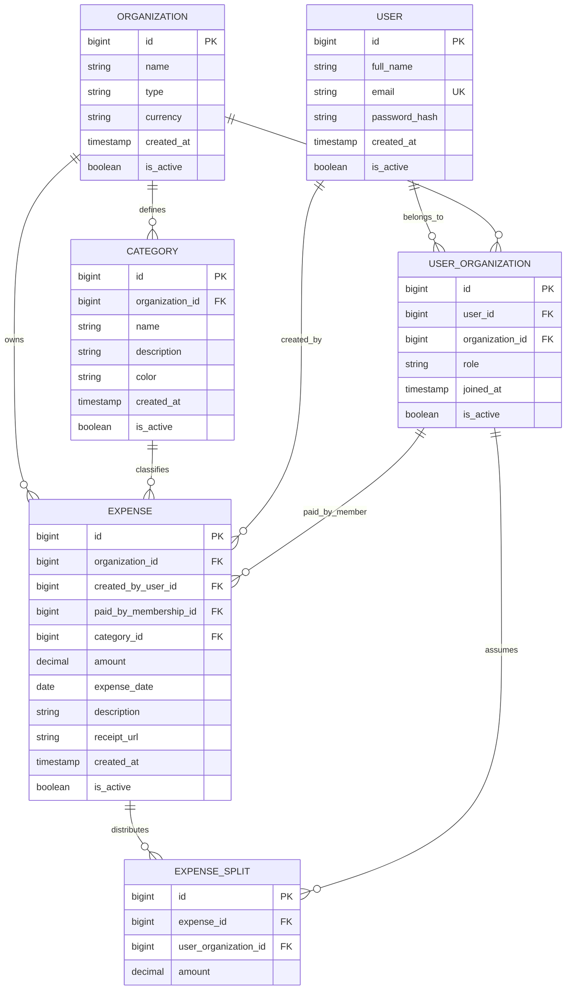

# 📊 Shareverance - Sistema de Gestión de Gastos Organizacionales

Sistema multi-tenant para la centralización, división, gestión y análisis predictivo de gastos aplicable a consorcios, universidades y hogares.

**Alcance MVP simplificado:**
- Registro y gestión de múltiples organizaciones.
- Usuarios con roles (`ADMIN` o `USER`) asignados por organización.
- Registro de gastos indicando fecha, importe, descripción, categoría y con quiénes se reparte (individual, con otro usuario, con varios o con todos).
- Un `ADMIN` puede cargar gastos en nombre de otro usuario de su organización.
- Análisis y proyecciones mensuales de gastos mediante el servicio predictivo.

Las reglas de negocio detalladas se documentan en [Reglas de negocio](docs/REGLAS_DE_NEGOCIO.md).

---

## 🛠️ Stack Tecnológico
* **Frontend:** React / TypeScript
* **Backend Transaccional:** Java (Spring Boot)
* **Microservicio Predictivo:** Python (FastAPI)
* **Base de Datos:** PostgreSQL

---

## Inicio rápido

Requisitos: Git y Docker Desktop iniciado, con contenedores Linux y Docker Compose 2.20 o posterior. En Windows se usa WSL 2. No es necesario instalar Java, Python, Node.js o PostgreSQL por separado. La primera ejecución necesita Internet para descargar imágenes y dependencias.

Los comandos siguientes se ejecutan en PowerShell.

### 1. Clonar el repositorio

```powershell
git clone https://github.com/seba615/shareverance shareverance
Set-Location shareverance
```
Si el entorno todavía está en una rama pendiente de integración, seleccionar esa rama antes de continuar: `git switch --track origin/NOMBRE_RAMA`. 

### 2. Crear la configuración local

```powershell
Copy-Item .env.example .env
```

Revisar las credenciales de `.env`. Este archivo es personal y no se sube a Git. Para el acceso directo a los servicios, si tienen algun puerto ocupado agregar a .env:

```dotenv
POSTGRES_HOST_PORT=5433
JAVA_HOST_PORT=8080
PYTHON_HOST_PORT=8000
```
Los puertos son de referencia, verificar cuales están libres en entorno local. 

### 3. Construir e iniciar

Desde la raíz del repositorio:

```powershell
docker compose -f compose.yaml -f compose.tools.yaml up --build -d --wait --wait-timeout 300
docker compose -f compose.yaml -f compose.tools.yaml ps
```

Los servicios deben aparecer como `healthy`. Las migraciones y los datos de demostración se cargan automáticamente; no crear tablas manualmente.

### 4. Comprobar el entorno

Abrir [http://localhost:5173](http://localhost:5173) y pulsar **Verificar conexiones**. Se espera `java: UP`, `database: UP`, `python: UP` y `demoRows: 2`.

Python queda disponible en [http://localhost:8000/docs](http://localhost:8000/docs). 

### 5. Detener el entorno

Desde la raíz del repositorio:

```powershell
docker compose -f compose.yaml -f compose.tools.yaml down
```

Este comando detiene y elimina los contenedores y la red del entorno. **Los datos de PostgreSQL se conservan en el volumen**, por lo que estarán disponibles cuando se vuelva a iniciar.

Para volver a levantar el entorno:

```powershell
docker compose -f compose.yaml -f compose.tools.yaml up --build -d --wait --wait-timeout 300
```

No agregar `-v` al comando `down` durante el uso habitual: esa opción también elimina el volumen y los datos de la base.

## Documentación

- [Guía de desarrollo y mantenimiento](docs/GUIA_DESARROLLO.md): actualización, ramas, servicios y agregado de bibliotecas.
- [Como se creó el entorno](docs/ENTORNO_INICIAL.md): cómo se creó la configuración y para qué sirve cada archivo.
- [Reglas de negocio](docs/REGLAS_DE_NEGOCIO.md): decisiones y temas pendientes.

---

## 📐 Modelo de Datos (DER)


El DER muestra exclusivamente las entidades indispensables para la gestión y división de gastos del MVP.

---

# Detalle de Entidades y Atributos

## 1. ORGANIZATION

Representa el grupo global o **tenant** del sistema (por ejemplo: consorcio, universidad o familia).

| Atributo | Tipo | Restricciones / Descripción |
|---|---|---|
| `id` | BIGINT | **PK**, Auto-increment. Identificador único. |
| `name` | VARCHAR(100) | Nombre de la entidad. Ej.: `"Edificio Central"`, `"Hogar Pérez"`. |
| `type` | VARCHAR(50) | Clasificación del dominio: `HOUSEHOLD`, `CONDO`, `UNIVERSITY`. |
| `currency` | CHAR(3) | Moneda de la organización (por defecto `ARS`). |
| `created_at` | TIMESTAMP | Fecha de alta de la organización. |
| `is_active` | BOOLEAN | Estado de la organización. Default: `true`. |

---

## 2. USER

Representa las cuentas y credenciales de los usuarios en la plataforma.

| Atributo | Tipo | Restricciones / Descripción |
|---|---|---|
| `id` | BIGINT | **PK**, Auto-increment. Identificador único. |
| `full_name` | VARCHAR(100) | Nombre completo del usuario. |
| `email` | VARCHAR(150) | Correo único para autenticación. **Unique**. |
| `password_hash` | VARCHAR(255) | Hash seguro de la contraseña. |
| `created_at` | TIMESTAMP | Fecha de registro. |
| `is_active` | BOOLEAN | Estado de la cuenta global. Default: `true`. |

---

## 3. USER_ORGANIZATION

Mapea la membresía y el rol de cada usuario dentro de una organización específica (relación N:M).

| Atributo | Tipo | Restricciones / Descripción |
|---|---|---|
| `id` | BIGINT | **PK**, Auto-increment. |
| `user_id` | BIGINT | **FK → USER.id**. Clave foránea al usuario. |
| `organization_id` | BIGINT | **FK → ORGANIZATION.id**. Clave foránea a la organización. |
| `role` | VARCHAR(20) | Rol dentro del grupo: `ADMIN` o `USER`. |
| `joined_at` | TIMESTAMP | Fecha de incorporación. |
| `is_active` | BOOLEAN | Membresía activa o deshabilitada. Default: `true`. |

**Restricción:** `UNIQUE(user_id, organization_id)`.

---

## 4. CATEGORY

Categorías de gastos configuradas por organización.

| Atributo | Tipo | Restricciones / Descripción |
|---|---|---|
| `id` | BIGINT | **PK**, Auto-increment. |
| `organization_id` | BIGINT | **FK → ORGANIZATION.id**. Organización a la que pertenece. |
| `name` | VARCHAR(100) | Nombre de la categoría (ej.: `"Supermercado"`, `"Servicios"`, `"Mantenimiento"`). |
| `description` | TEXT | Detalle opcional. **Nullable**. |
| `color` | VARCHAR(7) | Código hexadecimal para UI. Ej.: `#3B82F6`. |
| `created_at` | TIMESTAMP | Fecha de creación. |
| `is_active` | BOOLEAN | Habilitada para nuevos registros. Default: `true`. |

---

## 5. EXPENSE

Entidad transaccional central. Representa los egresos registrados.

| Atributo | Tipo | Restricciones / Descripción |
|---|---|---|
| `id` | BIGINT | **PK**, Auto-increment. Identificador del gasto. |
| `organization_id` | BIGINT | **FK → ORGANIZATION.id**. Tenant al que pertenece el gasto. La categoría y los participantes deben pertenecer al mismo tenant. El acceso de Python queda pendiente de contrato. |
| `created_by_user_id` | BIGINT | **FK → USER.id**. Usuario que registró el gasto. No identifica necesariamente al pagador; los pagos se registran por separado. |
| `paid_by_membership_id` |	BIGINT	| **FK → USER_ORGANIZATION.id**. Miembro a cuyo nombre se imputa el desembolso inicial (un ADMIN puede cargar en nombre de otro usuario). |
| `category_id` | BIGINT | **FK → CATEGORY.id**. Categoría vinculada al gasto. |
| `amount` | DECIMAL(12,2) | Monto monetario positivo, hasta 9.999.999.999,99; máximo dos decimales. |
| `expense_date` | DATE | Fecha del gasto, no futura. Admite antecedentes anteriores al alta de la organización. |
| `description` | TEXT | Detalle o concepto del gasto. **Nullable**. |
| `receipt_url` | VARCHAR(255) | URL o path del comprobante. **Nullable**. |
| `created_at` | TIMESTAMP | Timestamp de creación del registro. |
| `is_active` | BOOLEAN | Indica si el gasto está vigente. `true` = vigente, `false` = anulado/deshabilitado. Default: `true`. |

---

## 6. EXPENSE_SPLIT

Participación económica de cada miembro. Reemplaza la imputación única en EXPENSE. UNIQUE(expense_id, user_organization_id). No incluye un booleano paid: la liquidación requiere considerar movimientos. Modalidades de reparto y vinculación de liquidaciones por gasto pendientes de cierre.

| Atributo | Tipo | Restricciones / Descripción |
|---|---|---|
| `id` | BIGINT | PK, auto-increment. |
| `expense_id` | BIGINT | FK → EXPENSE.id. |
| `user_organization_id` | BIGINT | FK → USER_ORGANIZATION.id; participante de la misma organización. |
| `organization_id` | BIGINT | NOT NULL, y describí las claves foráneas compuestas que validan la organización.
| `amount` | DECIMAL(12,2) | Parte positiva asignada. Suma de partes = total del gasto. |

---

## 7. FUND_CONTRIBUTION

Dinero entregado al fondo. Solo la confirmación por ADMIN aumenta caja y crédito individual.

| Atributo | Tipo | Restricciones / Descripción |
|---|---|---|
| `id` | BIGINT | PK, auto-increment. |
| `organization_id` | BIGINT | FK → ORGANIZATION.id. |
| `contributor_membership_id` | BIGINT | FK → USER_ORGANIZATION.id; titular del crédito. |
| `amount` | DECIMAL(12,2) | Aporte positivo, puede exceder la deuda. |
| `movement_date` | DATE | Desde el alta de la organización, no futura. |
| `status` | VARCHAR(20) | PENDING, CONFIRMED, REJECTED o CANCELLED. |
| `created_by_user_id` | BIGINT | FK → USER.id; autor del registro. |
| `created_at` | TIMESTAMP | Generado por servidor. |
| `confirmed_by_membership_id` | BIGINT | FK → USER_ORGANIZATION.id; ADMIN que confirma. Nullable. |
| `confirmed_at` | TIMESTAMP | Fecha de confirmación. Nullable. |

---

## 8. EXPENSE_PAYMENT

Dinero pagado al proveedor por un miembro o por el fondo. No crea otro gasto. Cada pago identifica obligatoriamente el origen del dinero. Un pago personal no exige aporte previo ni disponibilidad de caja y, al confirmarse, genera crédito al pagador sin modificar el fondo. Solo un pago desde el fondo requiere caja disponible y la reduce al confirmarse. La política de confirmación de pagos directos aún no fue acordada.

Un mismo gasto puede pagarse con ambos orígenes mediante registros separados. Los pagos confirmados más pendientes vigentes no pueden superar el total del gasto. No registrar además un aporte al fondo por el mismo dinero utilizado en un pago personal: duplicaría el crédito.
Representa la porción del gasto asignada a cada participante según la modalidad elegida (con nadie, con otro usuario, con varios o con todos).

| Atributo | Tipo | Restricciones / Descripción |
|---|---|---|
| `id` | BIGINT | **PK**, auto-increment. |
| `expense_id` | BIGINT | **FK → EXPENSE.id**. |
| `user_organization_id` | BIGINT | **FK → USER_ORGANIZATION.id**; miembro participante de la misma organización. |
| `amount` | DECIMAL(12,2) | Parte asignada al participante. La suma de las partes debe ser igual al total de `EXPENSE.amount`. |

**Restricción:** `UNIQUE(expense_id, user_organization_id)`.

---

## Relaciones Principales
- **ORGANIZATION → USER_ORGANIZATION:** Una organización nuclea múltiples miembros (`ADMIN` o `USER`).
- **USER → USER_ORGANIZATION:** Un usuario puede pertenecer a más de una organización de forma aislada.
- **ORGANIZATION → CATEGORY:** Categorías propias de cada organización.
- **ORGANIZATION → EXPENSE:** Gastos centralizados por organización para su análisis mensual y predictivo.
- **USER → EXPENSE (`created_by_user_id`):** Quién registró el gasto en el sistema.
- **USER_ORGANIZATION → EXPENSE (`paid_by_membership_id`):** Miembro que pagó o asumió inicialmente el gasto (cargado por él mismo o por un `ADMIN` en su nombre).
- **EXPENSE → EXPENSE_SPLIT:** Distribución del gasto entre los participantes asignados.