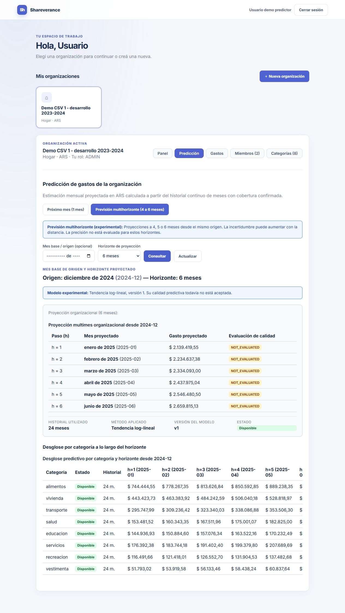
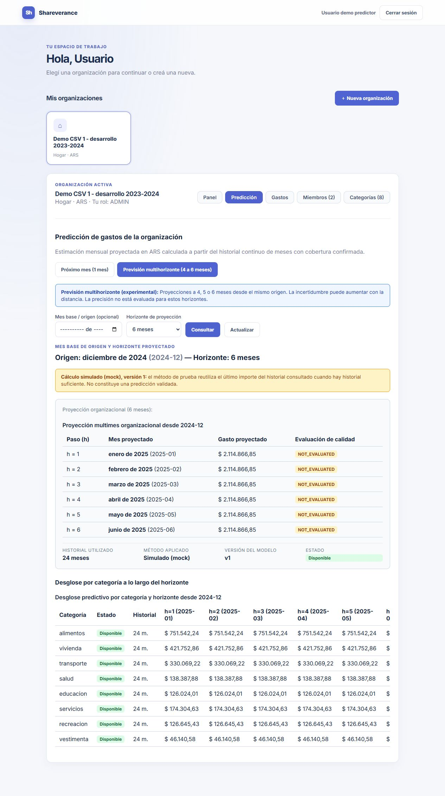
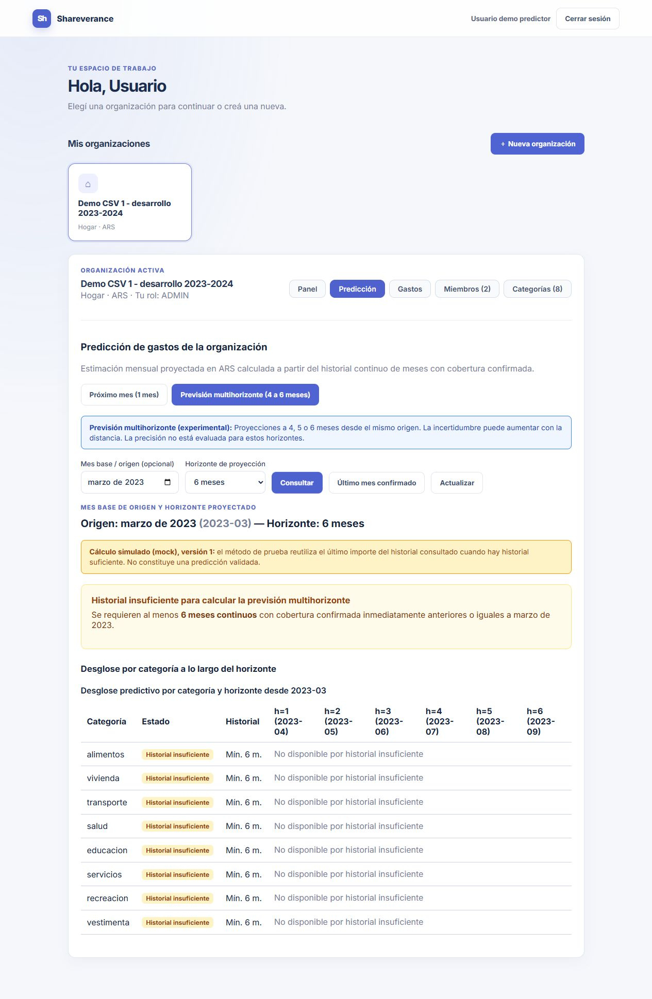
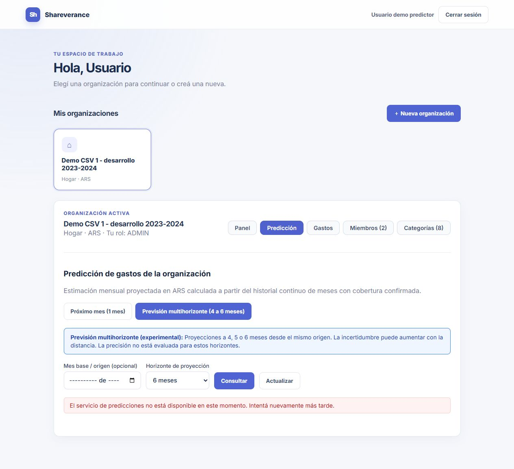
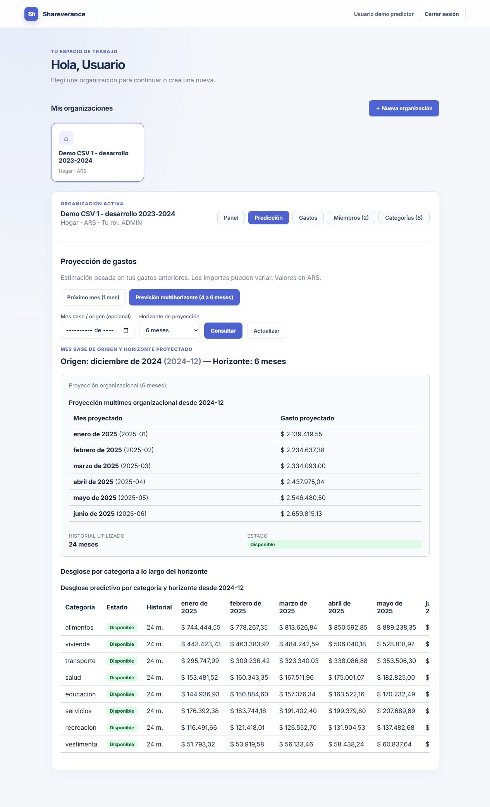

# Validación de la demostración sintética

Relacionado con [#85](https://github.com/seba615/shareverance/issues/85) y [#81](https://github.com/seba615/shareverance/issues/81). Base `380fd72`, cambios locales de preparación. La asignación de #81 se conserva; aceptación, integración y cierre son manuales.

## Objetivo y datos

La presentación utiliza el CSV V1 sintético disponible. No requiere conseguir datos reales para esta entrega; no afirma precisión sobre hogares argentinos ni promueve SES. La demostración integrada usa la organización CSV externa 1, ocho categorías, 192 gastos individuales de enero 2023 a diciembre 2024 y 24 meses confirmados, a través de Java y PostgreSQL. El CSV completo mantiene 50 hogares ficticios para evaluación offline; la demo no importa los 50 ni carga 2025 como historial.

Corte diciembre 2024; previsiones enero–abril/mayo/junio 2025 desde ese mismo origen, sin insertar proyecciones como gastos/cobertura. El modo predeterminado actual log_trend aprende la tendencia del historial: enero ARS 2.139.419,55 y junio ARS 2.659.815,13. No impone una inflación fija. Mock queda como referencia explícita opcional; sus capturas anteriores se conservan como evidencia histórica. Calidad NOT_EVALUATED y campos de métricas null; la evaluación sintética offline P4-H es separada y no se convierte en confianza individual.

## Ejecutar y presentar

Desde raíz, PowerShell y Docker Desktop Linux activo:

```powershell
.\scripts\predictor-demo.ps1 start
.\scripts\predictor-demo.ps1 load
.\scripts\predictor-demo.ps1 check
.\scripts\predictor-demo.ps1 check-forecast
```

Abrir http://localhost:5176. Acceso habitual de pruebas según [P1-D](../../python_predictor.md#entorno-demo-predictor), o cuenta técnica sintética `predictor.admin@example.test`, clave de demostración `DemoPredictor123!` (exclusivamente local). No usar credenciales reales. La cuenta habitual también conserva ADMIN en esta organización.

1. Elegir «Demo CSV 1 - desarrollo 2023-2024». En Gastos, comprobar 192 registros y filtrar diciembre 2024 si se desea mostrar los ocho totales sintéticos.
2. Panel: consultar enero 2023–diciembre 2024. Los gastos se importaron como agregados al último día del mes; el calendario no describe hábitos diarios reales.
3. Predicción: comprobar próximo mes enero 2025, el importe y la aclaración breve de estimación. Alternar a «Previsión multihorizonte», dejar origen vacío y consultar 4, 5 y 6 meses. Verificar encabezado, cantidad de filas y último objetivo abril/mayo/junio 2025.
4. Usar origen marzo 2023 y seis meses: historial insuficiente, sin importes inventados. Volver con «Último mes confirmado». Los controles de mes nativos pueden requerir entrada mediante el selector o confirmar segmentos; la automatización visual utilizó setValue nativo porque fill no conservó el valor en este navegador.
5. Explicar explícitamente origen sintético, corte histórico común, tendencia estimada a partir del historial y calidad individual no evaluada. Las categorías usan tabla con desplazamiento horizontal cuando el ancho no permite mostrar seis meses completos.

Detener conservando datos y volúmenes:

```powershell
.\scripts\predictor-demo.ps1 stop
```

Para repetir, start y check-forecast. load es repetible y rechaza divergencias; no borrar volúmenes para preparar la presentación. check-forecast sólo consulta negocio, además de iniciar sesiones de los usuarios de prueba; exige que load ya se haya ejecutado y el modo configurado en el ejemplo de demo. Comprueba los resultados del modelo seleccionado sin alterar gastos o cobertura.

## Actualización con tendencia real

La demo se volvió a construir y verificar con log_trend. [Resultado HTTP actual](resultado-tendencia.json): simulated false, 4/5/6 meses, equivalencia mensual, ocho categorías, insuficiencia, permisos y gastos/cobertura sin cambios. Carga repetida creó cero gastos. Suite Python: 135 aprobadas y 2 omitidas; scripts 48 aprobadas; frontend 42 aprobadas y build correcto. Java conserva el resultado de la corrección previa: 87 ejecutadas y 50 omitidas, sin fallos. [Evaluación offline y reproducción](../tendencia/README.md).



Captura real al ancho disponible de 1265 px; las categorías tienen desplazamiento horizontal. No certifica toda la matriz responsiva ni aceptación humana. El entorno quedó disponible en localhost:5176 para revisión; stop conserva sus volúmenes.

## Comprobaciones anteriores con mock

Estas comprobaciones y las tres capturas siguientes preceden a la activación de la tendencia real; no describen el modelo predeterminado actual.

- El primer start falló en build por fields points/horizon_step inexistentes. Corregidos a forecasts/horizon del DTO vigente.
- El loader retenía horizonte 4 por cierre de estado inicial. Ahora envía horizonte por consulta; una regresión comprueba 4→6→5 y descarte de respuestas antiguas.
- La consulta HTTP forecast daba 403 para miembros válidos porque el autorizador no incluía la ruta. Se habilitó exclusivamente GET forecast para miembros activos, conservando rechazo a organización ajena, POST y analytics/forecast.
- 41 pruebas frontend y build correctos. Construcción Java: 137 casos, cero fallos/errores, **50 omitidos** (87 ejecutados); no se atribuye integración PostgreSQL a esa suite.
- Wrapper test: 47 pruebas de scripts aprobadas (las 43 anteriores más cuatro del nuevo verificador). Pruebas de calidad desconocida, horizonte incorrecto, secuencia de objetivos, cruce de año y null ante insuficiencia.
- load integrado creó cero gastos sobre la demo existente y concilió analítica de 24 meses. check-forecast comprobó 4/5/6, origen automático y explícito, h=1 equivalente a monthly, ocho categorías, insuficiencia (2023-03 y 2022-12), 400 por parámetros inválidos y 403 para usuario ajeno. Gastos y cobertura idénticos antes/después. [Resumen HTTP](resumen.json).
- Con Python detenido exclusivamente en la demo: forecast devolvió 503 controlado y los 192 gastos siguieron disponibles. En navegador se verificó el aviso y navegación a Gastos. Python reiniciado después; check-forecast se repitió correctamente. Al terminar se ejecutó stop, conservando datos y volúmenes.
- Verificación visual: 4, 5 y 6 meses, insuficiencia y fallo de servicio. Capturas al ancho normal del navegador (1265 px), sin certificar toda la matriz responsiva, teclado/lector de pantalla ni aceptación humana.







## Límites y pendientes

La UI integrada muestra tablas de organización y categorías. El gráfico que combina histórico y previsión sigue pendiente; no se declara P5-H completo por esta validación. Tampoco se certifica validación exhaustiva del DTO de respuesta en Java, todas las combinaciones de categorías/cobertura ni precisión real. La aceptación humana debe revisar los criterios restantes del roadmap; no se cierran tareas.

2025 ya fue consultado en experimentos previos: puede mostrarse como datos sintéticos posteriores al corte sin llamarlo reserva independiente intacta. No se ejecutó una evaluación de errores de 2025 en esta tarea. Conseguir datos reales no es una condición de la presentación sintética; permanece como una eventual ampliación fuera de ese criterio de entrega.


## Presentación final del MVP

La vista ya no muestra método, versión, experimental ni NOT_EVALUATED. Se conserva la aclaración de estimación y el aviso de simulación cuando corresponde. La captura 04 y las anteriores son históricas; la captura 05 registra el diseño final. Pruebas posteriores al cambio: 41 frontend aprobadas y build correcto. Los resultados técnicos de evaluación se conservan en esta documentación y en el contrato, sin traducirse en una certificación de calidad al usuario.


