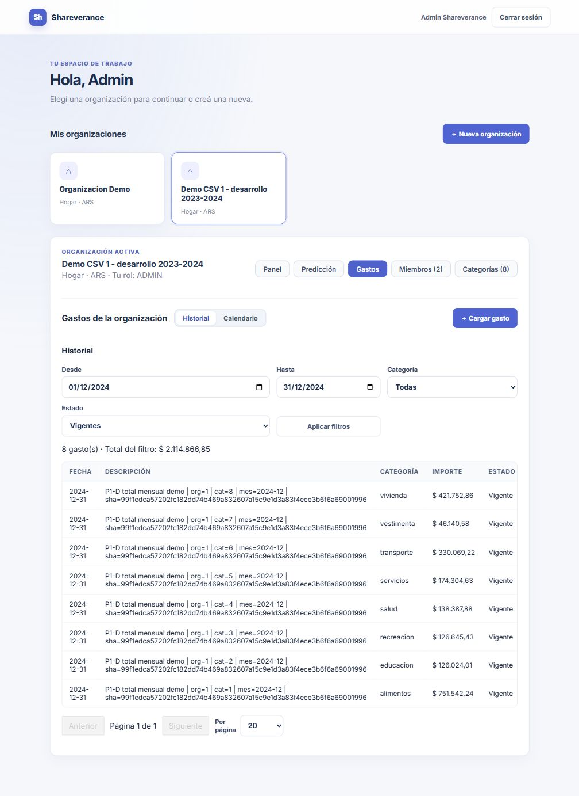
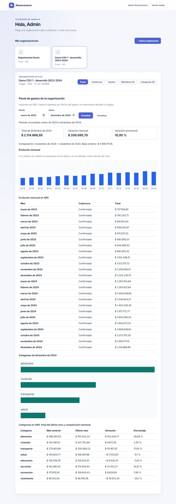
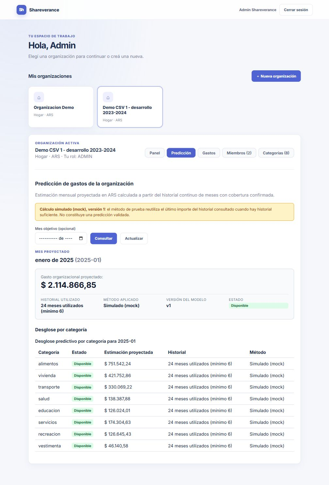
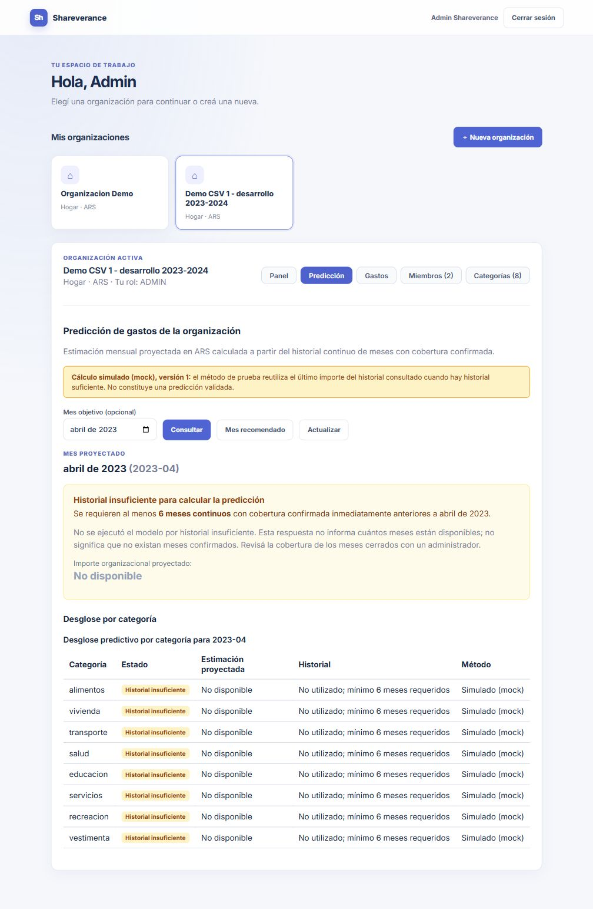

# Evidencia de pruebas P1-D

Capturas del 21/10/2026 en localhost:5176 con la resolución ampliada por el usuario. Datos de demostración públicos adaptados, sin comprobantes reales ni credenciales visibles. Evidencia de interfaz, no una especificación adicional ni aceptación predictiva.

Reproducir desde la raíz con Docker Desktop Linux y PowerShell:

```powershell
.\scripts\predictor-demo.ps1 start
.\scripts\predictor-demo.ps1 load
.\scripts\predictor-demo.ps1 test
.\scripts\predictor-demo.ps1 check
# Al terminar, conservando datos:
.\scripts\predictor-demo.ps1 stop
```

Acceso y detalle en la [guía normativa](../../python_predictor.md#entorno-demo-predictor).

Resultado: ocho regresiones unitarias aprobadas; 192 gastos/192 partes, ocho categorías y 24 meses confirmados; total ARS 31.211.212,92. Repetición sin altas nuevas. Conciliación por Java→Python→PostgreSQL, predicción enero 2025 por ARS 2.114.866,85 y rechazo HTTP 403 al usuario ajeno. Detención/arranque y persistencia comprobados previamente en el proyecto aislado. La denegación fue comprobada por HTTP, no fotografiada.

## Historial de diciembre de 2024

Ocho gastos vigentes, total ARS 2.114.866,85. Las descripciones identifican totales sintéticos y la versión del CSV. Las tablas conservan desplazamiento horizontal si exceden el ancho disponible.



## Panel de enero de 2023 a diciembre de 2024

24 meses confirmados; diciembre ARS 2.114.866,85, variación ARS 208.695,70 y 10,95 %. Las tablas muestran valores y categorías; los gráficos pueden desplazarse y no necesariamente muestran todas sus barras simultáneamente.



## Predicción mock de enero de 2025

24 meses utilizados y advertencia explícita de que no es una predicción validada.



## Insuficiencia para abril de 2023

Importe no disponible y explicación del mínimo de seis meses; no se informa cero como estimación.



No se probó aquí SES, OCR ni previsión multimes. La revisión visual en estos anchos no certifica accesibilidad o diseño responsivo integrales. La validación humana y aceptación final permanecen manuales.
