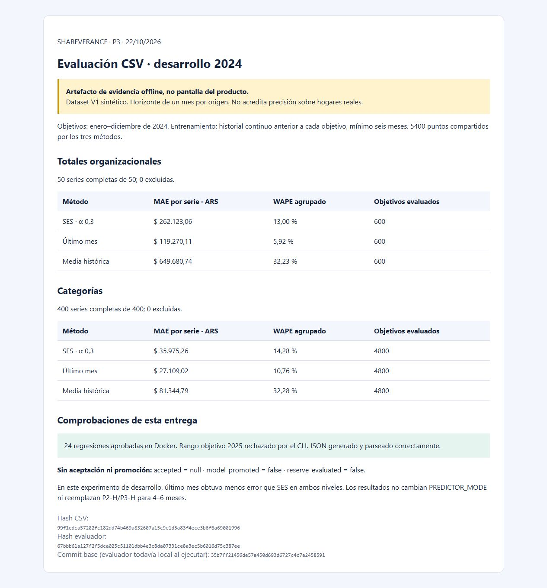
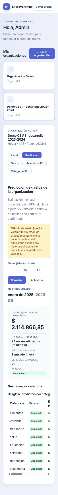

# Evidencia P3 — 22/10/2026

Entrega del evaluador offline de desarrollo. La primera captura es un **artefacto estático de evidencia**, generado desde el informe JSON; no es una pantalla nueva del producto. La segunda comprueba la interfaz existente con mock en el ancho estrecho del navegador. No acredita aceptación predictiva ni revisión responsiva integral.

## Reproducción

Desde la raíz, Docker Desktop Linux y PowerShell:

```powershell
New-Item -ItemType Directory -Force backend-java/target/p3 | Out-Null
.\scripts\predictor-demo.ps1 test
.\scripts\predictor-demo.ps1 evaluate -FromMonth 2024-01 -ToMonth 2024-12 > backend-java/target/p3/desarrollo.json
```

24 regresiones aprobadas; JSON generado/parseado correctamente. El wrapper rechazó `-FromMonth 2025-01 -ToMonth 2025-12` con salida fallida. No se calcularon errores de reserva. El [resumen JSON](resumen.json) conserva parámetros, hashes y métricas por nivel del informe ejecutado; el commit indicado es la base previa a los cambios locales y el hash del evaluador identifica el archivo utilizado.

Ver la [guía normativa](../../python_predictor.md#evaluador-p3) para formato, exclusiones y límites. El HTML de evidencia puede abrirse localmente; no necesita servicios ni forma parte de React.

## Resultados de desarrollo

50 organizaciones y 400 categorías completas, sin exclusiones; 5.400 puntos para tres métodos. Último mes obtuvo menos MAE que SES en ambos niveles. Esto no elige ni activa el método operativo; el dataset V1 es sintético.



## Comprobación del producto existente

Se inició exclusivamente el entorno aislado con `scripts/predictor-demo.ps1 start`, se ejecutó `check` correctamente y se revisó acceso ADMIN, selección de organización CSV y pestaña Predicción. El historial conservó 192 gastos y ARS 31.211.212,92. La pestaña sigue en mock con 24 meses, objetivo enero 2025 y ARS 2.114.866,85, con aviso de no aceptación. Generar esa previsión desde historia hasta 2024 no evalúa los reales reservados de 2025. La tabla ancha tiene desplazamiento horizontal en este ancho. No hubo cambios en React ni nuevos gráficos del producto.



No se ejecutaron suites integrales Java/React, OCR, SES operativo ni horizonte 4–6 meses. Servidor temporal de evidencia retirado y entorno demo detenido al finalizar; datos/volúmenes conservados. Aceptación final manual.
