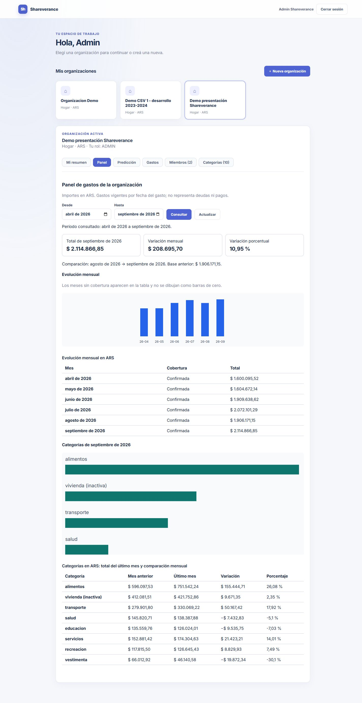
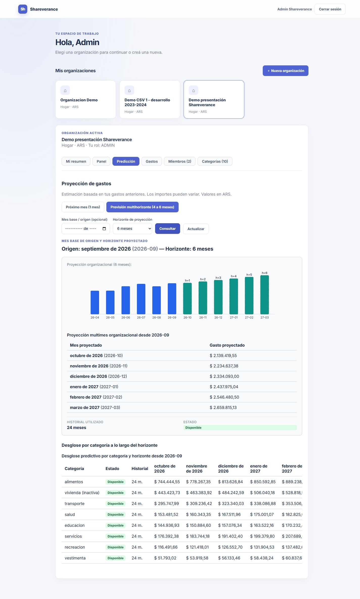
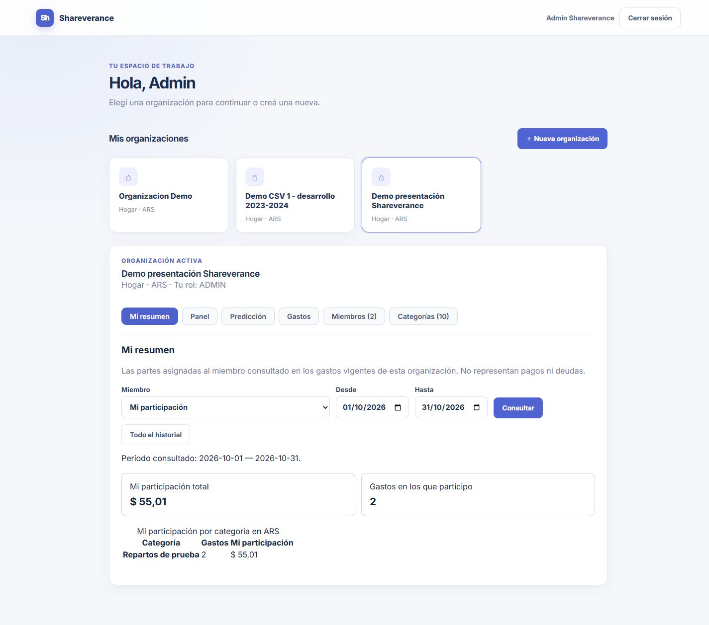
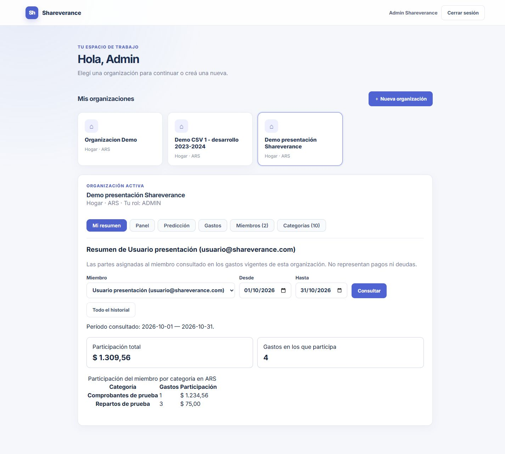

# Evidencia de la demo única de presentación

Relacionado con #95. Base d18408d y cambios locales de resumen/datos de presentación, sin commit de esta entrega todavía. [Guion, cuentas, comandos y fechas](../../demo_presentacion.md). Proyecto persistente único shareverance-predictor-demo y una organización del recorrido; no se eliminaron las demos técnicas ni volúmenes habituales.

Ejecutado: presentation-demo.ps1 prepare inició el mismo entorno y cargó 197 referencias por Java (196 vigentes, una anulada); repetición creó cero gastos. check pasó con OCR Tesseract, vistas PostgreSQL, predicción y resumen reales. [Resultado integrado](resultado.json). Se aplicó desplazamiento de 21 meses a la selección sintética CSV; no se alteró el CSV ni se evaluaron errores de predicción para aceptación. Los importes históricos totalizan ARS 31.211.212,92 y los resúmenes generales concilian con partes activas.

Tres pruebas unitarias del plan aprobadas: desplazamiento mensual sin alterar importes/universo, reparto exacto/centavo por ID y participantes inválidos. Build/integración de servicios ya ejecutados al preparar. No se repitieron suites completas Java/React por estos scripts; la ampliación del resumen conserva su evidencia separada de 96 pruebas Java ejecutadas/50 omitidas y 48 frontend aprobadas.

OCR sintético nítido reconoció 15/10/2026 y ARS 1.234,56 y el comprobante quedó asociado a un gasto de referencia. La imagen blanca devolvió fecha/importe null y descripción Varios con avisos; no se creó gasto (197 antes/después). [Resultado del caso sin texto](ocr-sin-texto.json). La subida blanca dejó un comprobante temporal sintético sin asociación, sujeto al mantenimiento habitual; no se purgó nada. Los PNG están versionados y su generador es scripts/generate_presentation_receipts.py, con Pillow ya declarado por OCR.

Verificación visual del conjunto oficial (ADMIN habitual puede conservar otras organizaciones): Panel abril–septiembre 2026 con total de septiembre ARS 2.114.866,85 y categorías históricas; Predicción inicia cuatro meses desde septiembre y combina gráfico histórico/proyección; la captura renovada muestra la selección de seis meses (octubre 2026–marzo 2027). Capturas renovadas el 25/10/2026 con viewport de escritorio 1440 × 1000 y página completa, sustituyendo el formato móvil. Se revisó su legibilidad; no certifican teclado/lector de pantalla ni toda la matriz responsiva. Los pasos de edición, invitación, concurrencia y registro quedan preparados para revisión humana, no se declaran ejecutados en esta comprobación.

Para noviembre 12/19, usar los períodos fijos del guion, no depender del rango automático de la computadora. Preparar/check antes del día; start conserva ensayos y stop conserva volúmenes. No se afirma aceptación integral ni se cambian estados/cierre de tareas.

Actualización de accesos: admin@shareverance.com y usuario@shareverance.com con la misma clave habitual local; auxiliares invitado@shareverance.com y ajeno@shareverance.com. El ADMIN existente se reutiliza sin cambios de contraseña. Se preparó el conjunto oficial para estas cuentas preservando la copia técnica y sus partes; check identifica la organización. PRESENTATION_PASSWORD se suministra por entorno o .env.local ignorado, sin publicar la clave. Cinco pruebas del plan/credenciales aprobadas; incluyen ausencia de clave y rechazo de login del ADMIN sin intento de registro/restablecimiento. Resultados y capturas se renuevan con los accesos confirmados.
