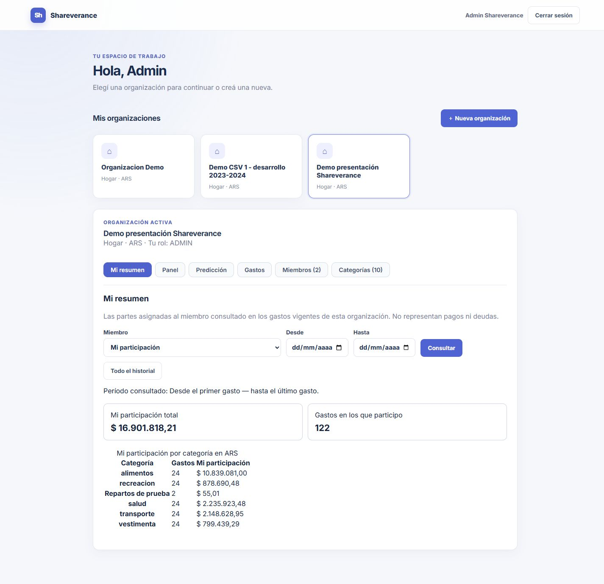

# Resumen individual: evidencia #95

Base d18408d, cambios locales en feat/resumen-individual. Pestaña Mi resumen: partes del usuario conectado o del miembro seleccionado por ADMIN en gastos vigentes, no gasto organizacional completo, pagos ni deudas. No incluye cobertura; USER no puede seleccionar otro miembro.

## Repetir la demo

Desde raíz con PowerShell y Docker Desktop Linux:

```powershell
./scripts/predictor-demo.ps1 start
./scripts/predictor-demo.ps1 load
# Abrir http://localhost:5176 y elegir Demo CSV 1 - desarrollo 2023-2024, Mi resumen.
./scripts/predictor-demo.ps1 stop
```

Cuenta técnica sintética de la [guía P1-D](../../python_predictor.md#entorno-demo-predictor); stop conserva volúmenes. El usuario habitual puede no tener partes asignadas y mostrar cero correctamente: ser ADMIN o autor no asigna participación por sí solo. No se añadieron gastos a la demo para esta tarea. Los 192 gastos existentes son individuales; el reparto igualitario se comprueba en PostgreSQL temporal separado.

Verificado visualmente con cuenta técnica: todo el historial, 192 participaciones por ARS 31.211.212,92, ocho categorías; filtro 2024-12-01 a 2024-12-31, ocho por ARS 2.114.866,85. La comprobación original usó ancho móvil de 320 px. Las capturas se renovaron después con la demo única y formato de escritorio, según la nota siguiente; no certifican toda la matriz responsiva ni aceptación humana.

### Capturas renovadas de la demo única, 25/10/2026

Las dos imágenes actuales corresponden a **Demo presentación Shareverance**, con viewport 1440 × 1000 y captura de página completa. Sustituyen las imágenes móviles de los conjuntos técnicos anteriores; sus comprobaciones numéricas previas se conservan como evidencia histórica, no como los valores mostrados en las imágenes nuevas.

01-mi-resumen muestra todo el historial del ADMIN de presentación: ARS 16.901.818,21 en 122 participaciones. 02-admin-otro-miembro muestra octubre 2026 de usuario@shareverance.com: ARS 1.309,56 en cuatro gastos (incluye el comprobante sintético). Las cifras de ARS 75,00 y de la antigua organización CSV describen ejecuciones anteriores. El [guion único](../../demo_presentacion.md) identifica cuentas, fechas y datos vigentes de presentación.



## Pruebas ejecutadas

Frontend: 45 aprobadas, cero fallos u omisiones y build TypeScript/Vite correcto. Incluye renderizado de categorías inactivas y cero sin participación; se reutiliza el cargador probado contra respuestas antiguas.

Java: 144 casos, 94 ejecutados, 50 omitidos y cero fallos/errores. Incluye tres pruebas del nuevo servicio y cuatro de IndividualSummaryPostgresTest con PostgreSQL 17.11 real, base exclusiva shareverance_summary_test sin puertos, almacenamiento tmpfs. Migraciones V1–V9 vigentes; SQL parametrizado. Verificado: $10,01 repartidos aporta sólo $5,01 al miembro, autor/titular sin parte no aporta, anulado/otro mes/otro tenant excluidos, categoría inactiva preservada, fechas inclusivas y extremos opcionales, cero vacío, total conciliado con categorías, 401 sin sesión, 403 sin membresía/organización, POST rechazado, 400 fecha/rango inválidos y userId enviado no sustituye identidad de sesión.

El primer intento de test no compiló por una importación faltante del manejador de errores; corregida y suite repetida satisfactoriamente. No se atribuyen las otras integraciones SQL omitidas a esta ejecución. Comandos PostgreSQL aislados en el [roadmap](../../road_map.md); no usar esas pruebas contra datos habituales. No se ejecutó evaluación del predictor por este cambio.

La demo queda disponible en localhost:5176 para revisión. La base temporal de pruebas se retira después de verificar su etiqueta; no se eliminan volúmenes de la demo ni datos habituales. Aceptación e integración manuales.


## Casos compartidos y consulta ADMIN

Después de start (y load si se desea conservar también la demo CSV):

```powershell
./scripts/predictor-demo.ps1 load-summary
```

Usa exclusivamente el proyecto/base shareverance-predictor-demo. Crea por API la organización **Demo resumen individual - repartos**, con ADMIN predictor.admin@example.test y USER resumen.miembro@example.test. Ambas cuentas son sintéticas y usan DemoPredictor123! sólo localmente. No modifica las 192 filas de la organización CSV ni crea cobertura. La repetición verifica marcadores, partes y totales; no sobrescribe gastos divergentes ni membresías/categorías ajenas. Un fallo parcial puede completarse repitiendo si los datos siguen concordando.

| Gasto | ADMIN | USER | Estado |
| --- | ---: | ---: | --- |
| Iguales $10,01 | $5,01 | $5,00 | Vigente |
| Iguales $100,00 | $50,00 | $50,00 | Vigente |
| Individual del miembro $20,00 | $0,00 | $20,00 | Vigente |
| Iguales $9,99 | Excluido | Excluido | Anulado |
| Total de participación | $55,01 (2 gastos) | $75,00 (3 gastos) | $130,01 vigentes |

El centavo de resto se asigna por ID de membresía ascendente; el creador ADMIN tiene el ID menor en esta organización nueva. La carga verifica esa regla según IDs reales. Entrar como ADMIN, seleccionar organización/Mi resumen y elegir el otro miembro. Como USER no se muestra selector y una petición directa al resumen ajeno devuelve 403. ADMIN puede consultar un miembro inactivo de su organización; la membresía del solicitante siempre debe estar activa.

Para detener, scripts/predictor-demo.ps1 stop conserva todo. La carga no purga datos ni ofrece acceso a otras organizaciones. No usar sus credenciales fuera del entorno local.


### Comprobación ampliada ADMIN y repartos

Suite Java repetida: 146 casos, 96 ejecutados, 50 omitidos y cero fallos/errores; incluye seis pruebas PostgreSQL reales (las cuatro anteriores más ADMIN→otro/inactivo/otro tenant y USER→propio/ajeno). Frontend final: 48 aprobadas y build correcto, con renderizado del selector según rol y etiquetas que no atribuyen al solicitante los importes de otra persona.

load-summary ejecutado contra Java/PostgreSQL reales de la demo: ADMIN $55,01 / 2 gastos y USER $75,00 / 3 gastos, anulado excluido y acceso USER→otro 403. Primera carga quedó parcial al detectar que el tipo persistido igualitario es EQUAL, distinto del valor de solicitud ALL_MEMBERS; corregida esa verificación, se completó la carga por API. Repetición final creó cero gastos y conservó los mismos totales. [Resultado HTTP sintético](resultado-compartidos.json). No se alteró la organización CSV. El contenedor PostgreSQL temporal de la suite se retira tras comprobar etiqueta; la demo se mantiene en localhost:5176.


Revisión visual ampliada: ADMIN selecciona resumen.miembro@example.test y ve $75,00 en tres gastos. El selector identifica nombre/email y las membresías inactivas; ajuste de quiebre de texto para direcciones largas en pantalla angosta. La captura renovada utiliza ahora el miembro de la demo única, como se identifica arriba:


